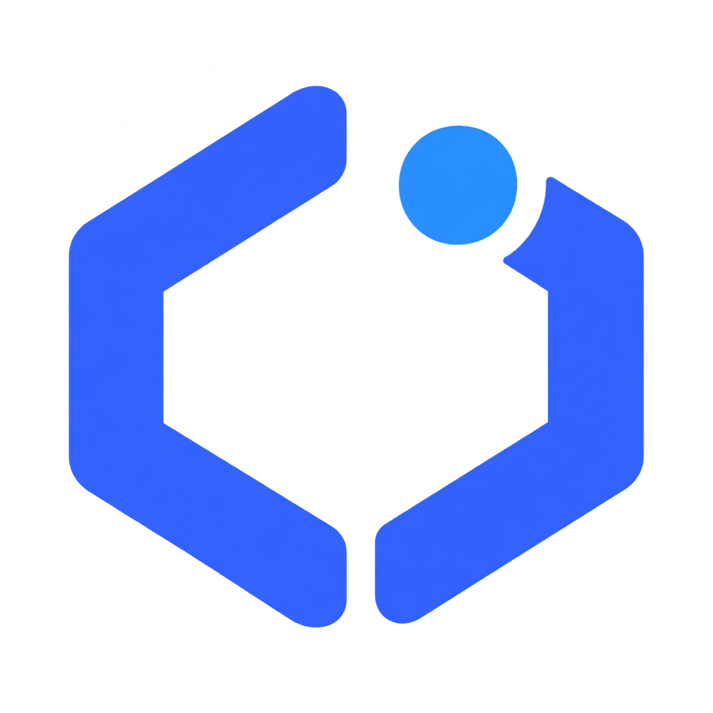
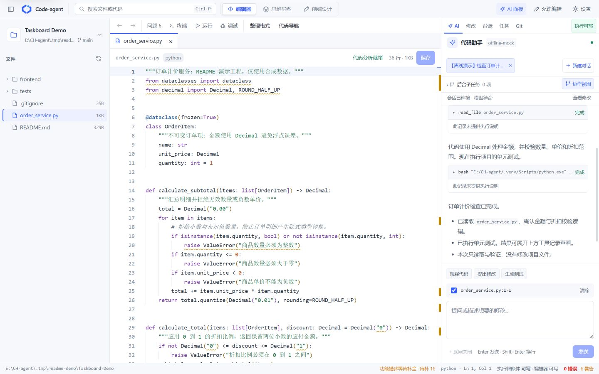
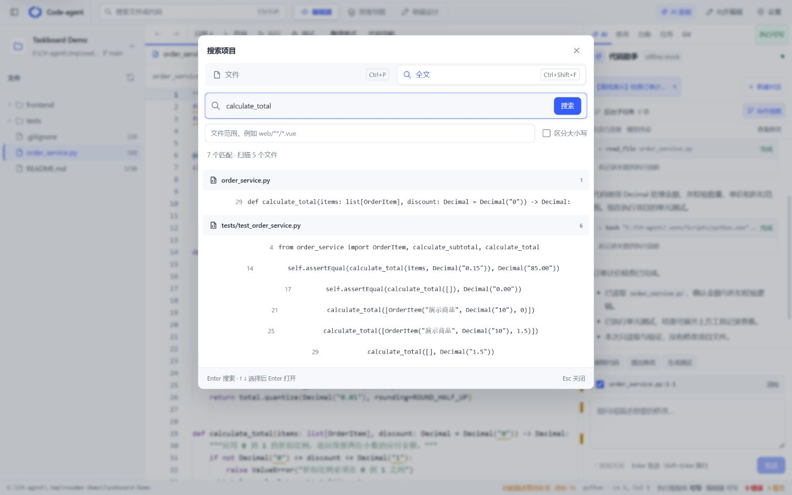
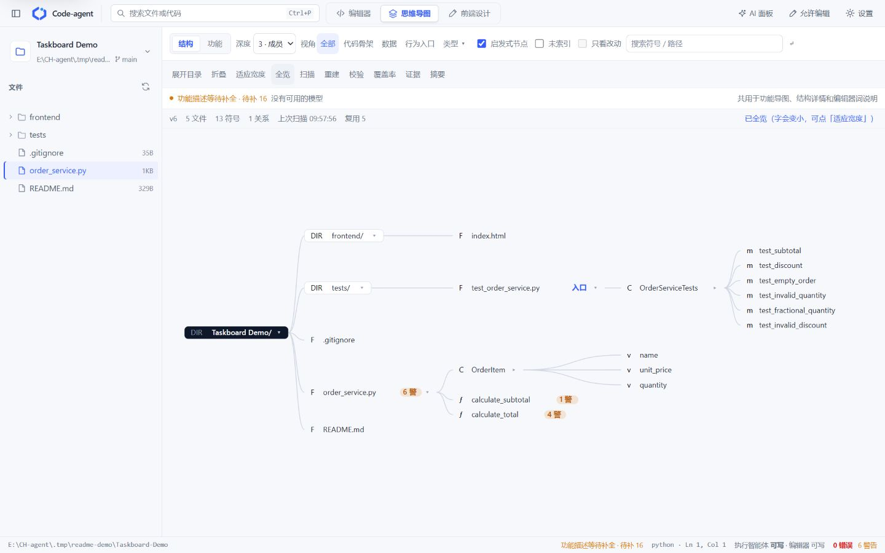
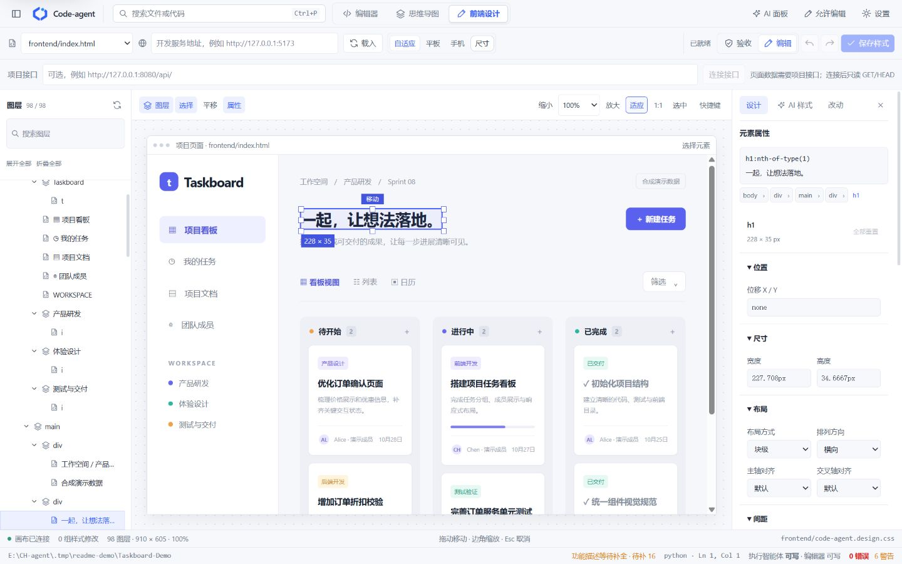
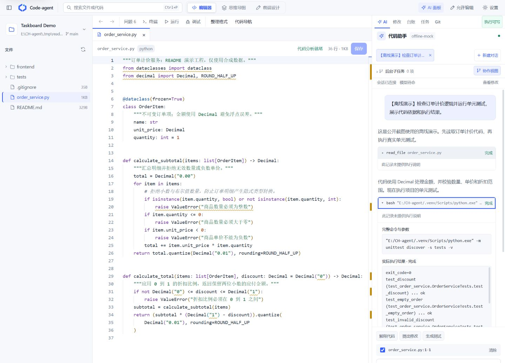
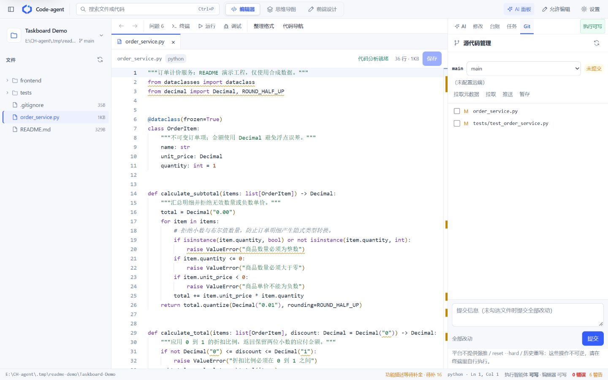

<p align="center">
  
</p>

<h1 align="center">Code-agent · 编码智能体</h1>

<p align="center">把代码编辑、AI 协作、项目地图和前端设计放进同一个工作台。</p>

Code-agent 是一个在本地运行的 AI 编码工作台。你可以打开自己的项目，浏览和修改代码、让智能体执行开发与修复任务、查看工具调用和代码差异，再运行测试完成验证。

后端基于 **Python + FastAPI**，前端基于 **Vue 3 + Monaco Editor**。支持 DeepSeek、OpenAI 兼容接口和离线演示，项目数据保存在本机。



[功能预览](#功能预览) · [快速开始](#快速开始) · [模型配置](#模型配置) · [运行与部署](#运行与部署) · [项目结构](#项目结构)

## 功能预览

### 代码编辑与统一搜索

- Monaco 多文件编辑器，支持代码高亮、保存、诊断、代码导航，以及接入语言服务器后的语义能力。
- 文件名与代码全文搜索共用一个入口，可按范围和大小写筛选，直接跳到命中的文件、行和列。
- 使用 `Ctrl+P` 查找文件，`Ctrl+Shift+F` 搜索代码，`Ctrl+S` 保存文件。



### 代码思维导图

以可浏览的地图呈现项目目录、文件与符号，通过节点定位代码、查看关联信息。文件编辑后索引与地图在后台更新，适合快速了解项目结构和调用关系。

不同语言的解析与语义能力取决于对应解析器、语言服务器和本机工具环境。



### 可视化前端设计

在真实页面预览中选择元素，通过图层树和属性面板调整位置、尺寸与样式。支持画布缩放和平移、拖动与缩放元素、撤销重做、设备尺寸预览，以及保存样式修改。

静态页面可直接选择 HTML 入口；Vue、React 等项目可填写已运行的前端开发服务地址。



### AI 助手与按需多智能体协作

Lead 可以独立读取代码、修改文件、运行工具并验证结果；适合并行的任务可按文件范围、依赖和交付目标委派给子智能体，结果在主对话中汇总。

工具调用展示参数、执行状态与返回结果。需要授权的操作通过审批继续执行，会话与执行记录可回看。MCP、技能、插件、记忆和知识库可在设置中管理。



### Git、终端与调试

- Git 面板集中管理分支、待提交文件和远程同步，修改面板可审阅代码差异；任务需要隔离时可使用独立工作树。
- 集成终端、项目运行和测试入口，执行结果与当前项目关联。
- 支持 Python 和 Java 断点调试；Java 调试需要 JDT LS 与 Microsoft java-debug 插件。JavaScript / Vue 调试尚未接入。



> 配图来自实际工作台，使用合成的 Taskboard Demo 项目。离线演示中的工具读取、文件保存和测试执行均在隔离工程内完成；预置演示回答不代表真实模型的任务成功率或性能。

## 快速开始

### 使用 npx 下载并启动

准备 **Node.js 20.11+** 和 **Python 3.11+**，运行：

```bash
npx --yes https://github.com/luyiyanyumu/Code-agent/releases/latest/download/code-agent.tgz
```

首次启动会下载应用、创建独立 Python 虚拟环境并安装后端依赖，然后自动打开 **[http://127.0.0.1:8765](http://127.0.0.1:8765)**。前端已随发行包构建，无需克隆仓库或执行 `npm ci`；之后启动会复用已安装的运行环境。

下载并准备最新版，暂不启动：

```bash
npx --yes --prefer-online https://github.com/luyiyanyumu/Code-agent/releases/latest/download/code-agent.tgz install
```

更新后，在旧服务终端按 `Ctrl+C` 停止，再将上述安装命令末尾的 `install` 去掉启动新版。会话、配置和密钥保存在 `~/.code-agent`，更新程序不会覆盖它们。启动后可在 **设置 → 模型与连接** 中配置密钥；追加 `--provider offline` 可体验离线演示。

当前发行渠道为 **GitHub Release**。更多命令、运行目录和自定义选项见 [npx 安装与更新](docs/npx.md)。

### 从源码开发

#### 1. 安装依赖

准备 **Python 3.11+**、**Node.js** 和 **Git**，然后克隆项目：

```bash
git clone https://github.com/luyiyanyumu/Code-agent.git
cd Code-agent
python -m venv .venv
```

激活 Python 虚拟环境：

```powershell
# Windows PowerShell
.\.venv\Scripts\Activate.ps1
```

```bash
# macOS / Linux
source .venv/bin/activate
```

安装后端与前端依赖：

```bash
pip install -e ".[dev]"
cd web
npm ci
cd ..
```

#### 2. 配置模型

将 `.env.example` 复制为 `.env`，再填写自己的模型配置。也可以启动后在 **设置 → 模型与连接** 中配置。

```dotenv
CODE_AGENT_PROVIDER=deepseek
DEEPSEEK_API_KEY=填写自己的密钥
```

`.env` 不应提交到版本库。可用配置与默认值见 [.env.example](.env.example)。

#### 3. 启动工作台

第一个终端，在项目根目录启动后端：

```bash
python -m code_agent.server --port 8765
```

第二个终端启动前端：

```bash
cd web
npm run dev -- --host 127.0.0.1 --port 5175 --strictPort
```

打开 **[http://127.0.0.1:5175](http://127.0.0.1:5175)**，选择项目目录即可使用。

Windows 用户完成依赖安装后，也可双击 `start-code-agent.vbs` 或 `start-code-agent.bat`；停止服务使用 `stop-code-agent.bat`。启动器使用前端 **5175**、后端 **8765** 端口。

没有模型密钥时，可将后端命令改为下面这一条体验离线演示：

```bash
python -m code_agent.server --provider offline --port 8765
```

离线模式用于演示和回归，不调用真实 AI 服务。

## 模型配置

| 接入方式 | 配置 |
| --- | --- |
| DeepSeek | `CODE_AGENT_PROVIDER=deepseek`、`DEEPSEEK_API_KEY` |
| OpenAI 兼容服务 | `CODE_AGENT_PROVIDER=openai_compat`、`OPENAI_BASE_URL`、`OPENAI_API_KEY`、`OPENAI_MODEL` |
| 离线演示 | `CODE_AGENT_PROVIDER=offline`，不需要模型密钥 |

环境变量优先于 `.env`。语言服务器、调试器、向量服务与外部 MCP 服务按需配置；它们的可用性取决于本机安装和连接状态。

## 运行与部署

### Docker

当前 Compose 使用本地前端构建产物，部署前先构建前端：

```bash
cd web
npm ci
npm run build
cd ..
docker compose up -d --build
```

打开 **[http://localhost:8080](http://localhost:8080)**。应用数据保存在 `agent-data` 卷中。

### 数据与访问

- 本地数据默认位于 `~/.code-agent`，可通过 `CODE_AGENT_HOME` 指定其他目录。
- 会话、记忆、配置和执行记录存放在本机；调用外部模型或工具时会发送任务需要的数据。
- 默认是免登录的本地单用户模式；对外提供服务前，应配置认证、访问边界和自己的管理员密码。
- 功能需要审批时仍需显式授权，离线模式和多智能体不会绕过权限判断。

### 开发验证

```bash
# 项目根目录
python -m pytest

# 前端
cd web
npm test
npm run build
```

## 项目结构

```text
code_agent/          后端、Agent Loop、模型适配、工具、会话与项目索引
web/                 Vue 编码工作台与 Monaco 编辑器
chat-app/            独立通用对话应用，有自己的后端、配置和启动方式
tests/               后端测试与合成测试夹具
scripts/             启动、检查和开发验证脚本
docs/                功能说明与配图
```

更多说明：[npx 安装与更新](docs/npx.md) · [子智能体协作](docs/subagent-runtime.md) · [项目任务](docs/work-items.md) · [编码助手记忆](docs/memory.md) · [独立对话应用](chat-app/README.md)。
